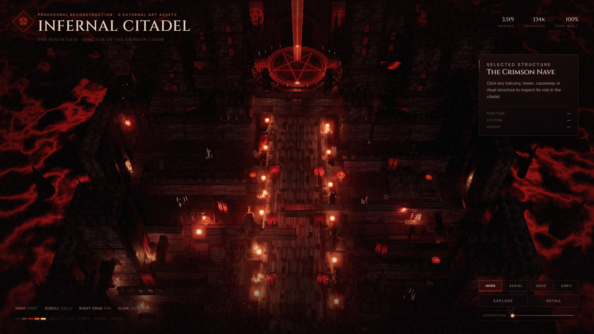

<div align="center">


# img2threejs

**把参考图重建成纯代码、可动画的 Three.js 模型。**

程序化、质量门禁、为 token 效率而设计——重建的是代码，不是摄影测量、网格提取或下载素材包。

[English](README.md) | **简体中文**

[](LICENSE)
[](CHANGELOG.md)
[](https://threejs.org)
[](forge)

</div>

> **Zerlin 的二开分支**
>
> 这个分支在 img2threejs 工作流之上，加入了两幅独立二次开发的 Three.js 场景：
> **Infernal Citadel** 与 **皮皮园 / Pipi Garden**。它们不是上游官方 Demo，
> 而是基于同一套“纯代码、程序化、可验证”方法完成的二开作品。
>
> 本中文版聚焦二开作品、运行方式与验证证据；上游完整开发文档仍以
> [English README](README.md) 与 `docs/`、`grimoire/` 为准。

[→ 直接看两幅作品](#二开作品)

---

## 二开作品

两幅场景都由代码生成：没有下载的模型、贴图、HDRI 或美术素材包。截图来自真实浏览器画面。

<table>
<tr>
<td width="50%" valign="top">
<a href="infernal-citadel/README.md"></a>
<h3>1. Infernal Citadel</h3>
<p><b>暗黑奇幻悬浮城</b><br/>
熔岩海之上的大教堂城塞：中轴巡礼长街、五芒星圣所与猩红光束、城墙分区、
翼状哨兵、石像鬼与悬链。</p>
<p>
<a href="infernal-citadel/README.md"><b>完整案例 →</b></a><br/>
<a href="renders/hero-ui.png">HUD 主视图</a> ·
<a href="renders/explode-ui.png">结构爆炸图</a> ·
<a href="renders/orbit-sheet.png">四向环视图</a>
</p>
<p><sub>约 3,519 个网格 · 134k 三角形 · 390 簇动态火焰 · 12 个哨兵</sub></p>
</td>
<td width="50%" valign="top">
<a href="pipi-garden/README.md"></a>
<h3>2. 皮皮园 · Pipi Garden</h3>
<p><b>互动小熊猫微缩花园</b><br/>
奶油纸面上的漂浮花园：画圈召唤、拖拽拎起、删除、旋转视角，
小熊猫会跟着大熊猫走。</p>
<p>
<a href="pipi-garden/README.md"><b>完整案例 →</b></a><br/>
<a href="pipi-garden/renders/stageb-overview.png">总览</a> ·
<a href="pipi-garden/renders/expanded-ground-8.png">扩展后的地台</a> ·
<a href="pipi-garden/renders/stageb-mobile.png">手机端</a>
</p>
<p><sub>20.8×20.8 地台（面积 3×） · 30 只上限 · 37 项浏览器检查 · 10 只 135–165 fps</sub></p>
</td>
</tr>
</table>

### 这个分支做了什么

- **Infernal Citadel**：单视角暗黑奇幻参考的程序化重建。建筑、旗帜、符文、
  火焰与烟雾贴图由 Canvas 2D 运行时绘制，岩浆和光束是 GLSL shader；运行时
  保留具名结构组，`Explode` 能把城塞按结构拆开，而不是移动一个合并网格。
- **皮皮园**：把同一套 code-only 方法做成可玩的疗愈玩具。画圈大小映射到
  小熊猫大小，拖拽会离地并在落点不可站立时吸附到最近空地；地台面积扩大到
  原来的 3 倍，外圈加入竹林、樱花、花海、围栏、灯笼和石径。
- **无外部美术资产**：两幅作品都不依赖下载的模型或图片；截图就是浏览器
  实际输出，不是概念图。

---

## 作品一：Infernal Citadel

**一句话**：一座漂浮在熔岩海上的暗黑大教堂城塞，从建筑结构到火焰、烟雾、
岩浆和猩红光束全部由代码生成。

### 看点

- **中轴巡礼长街**：约 10 米长的行进轴线、护墙、交叉节点、旗帜、烛台和
  前场下行台阶。
- **第九门与五芒星圣所**：抬高的八边形圣所、16 米五芒星嵌花、祈愿火盆环、
  巨型尖拱门和垂直猩红光束。
- **城墙与塔楼**：双棱堡、灰烬区、血回廊、铁幕外墙、残破雉堞与红色窗光。
- **动态氛围**：FBM 岩浆、热裂纹、余烬灯、层级烟雾、980 个余烬和 320 个
  灰烬粒子。
- **可检查结构**：点击结构显示包围盒和档案；`Explode` / 滑杆控制结构分离
  与合拢。

### 操作

| 输入 | 动作 |
| --- | --- |
| 左键拖拽 | 环绕 |
| 滚轮 | 推拉 |
| 右键拖拽 | 平移 |
| 点击结构 | 检查结构，更新红色包围盒与档案 |
| `Explode` / 滑杆 | 拆开 / 合拢主要结构组 |
| `Hero` / `Aerial` / `Nave` / `Orbit` / `Detail` | 预设机位 |

URL 参数：`?ui=0`、`?view=hero|aerial|nave|detail|orbit`、`?cam=...&look=...&fov=...`、
`?alpha=1`（透明背景轮廓）、`?exposure=`、`?bloom=`、`?fog=`。

### 运行

```bash
npm install
npm run scene:dev
# http://127.0.0.1:5173/
```

生产构建：

```bash
npm run scene:build
# dist-infernal-citadel/
```

### 实测与证据

- 约 **3,519 个网格**、**134k 三角形**、**11 盏灯**、**390 簇火焰**（最终
  Hero 视图；HUD 会实时采样）。
- 四方位 turntable 门禁、像素/轮廓对比、语义审查通过。
- 证据：[`evidence/visual-validation.md`](evidence/visual-validation.md)、
  [`renders/`](renders)、[`evidence/turntable-gate.json`](evidence/turntable-gate.json)。
- 已知限制：这是单视角风格化重建，背面、屋顶平面与未见空间为推断；确定性的
  fidelity 分数低于管线对物体重建的目标，因此记录为“接受的风格化”，而不是
  逐像素还原。

---

## 作品二：皮皮园 / Pipi Garden

**一句话**：奶油色纸面上的漂浮小花园，住着会走、会吃、会撒娇的小熊猫。

### 互动

| 输入 | 动作 |
| --- | --- |
| 在地面画圈 | 圈内召唤小熊猫；圈越大，熊猫越大 |
| 拖动小熊猫 | 拎起离地；松手在水面/障碍上会吸附到最近空地 |
| 点选 + `Delete` / `Backspace` | 删除选中的小熊猫（手机端有删除按钮） |
| 空白处拖拽 / 右键拖拽 | 旋转视角、调整俯仰；地块自动适配画框 |
| `↺ 45°` / `复位` / `45° ↻` | 相机预设；方向键也可旋转 |
| `?pandas=0` | 空花园，方便测试画圈 |

### 这一阶段新增

- **地台面积扩大到 3 倍**：从 12×12 扩到 20.8×20.8。
- **外围装饰**：第二棵樱花、外圈/中圈竹林、成片花海、灌木、苔石、蘑菇、
  木围栏、石灯笼、长椅、入口石径与环形踏步石。
- **池塘扩大**：锦鲤、荷叶、涟漪同步适配。
- **环境层扩大**：花瓣、浮尘、蝴蝶覆盖整个新地台；草丛实例从 2,400
  增至 8,000。
- **性能与移动端**：10 只小熊猫在 1600×1000 实测 **135–165 fps**，
  722 draw calls、830,735 triangles；390×844 手机端完整地台入画，鼠标与
  真实触摸画圈均通过。

### 运行与测试

```bash
npm run scene:pipi:dev
# http://127.0.0.1:5176/

npm run scene:pipi:build
npm run scene:pipi:preview
# http://127.0.0.1:5177/

npm run scene:pipi:test
# 37 项交互检查（需要 dev server 已启动）
```

单文件构建：

```bash
npm run scene:pipi:bundle
# dist-pipi-garden/pipi-garden.html
```

### 证据与限制

- 交互测试：[`pipi-garden/evidence/interaction-test.json`](pipi-garden/evidence/interaction-test.json)
- 阶段报告：[`pipi-garden/evidence/stageb-validation.md`](pipi-garden/evidence/stageb-validation.md)
- 视觉复核：[`pipi-garden/evidence/stageb-review.json`](pipi-garden/evidence/stageb-review.json)
- 已知限制：30 只是硬上限，画面会明显拥挤；3× 地台会让自动取景相机后退，
  小熊猫比原 12×12 版本小；低端手机未做 10 只 60fps 基准。

---

## 快速开始

环境要求：**Node.js ≥ 18**、Git；完整 img2threejs 技能另需 Python ≥ 3.10
和 Claude Code / Codex / OpenCode / Hermes 之一。

```bash
npm install

npm run scene:dev          # Infernal Citadel 开发预览
npm run scene:build        # Infernal Citadel 生产构建

npm run scene:pipi:dev     # 皮皮园开发预览
npm run scene:pipi:build   # 皮皮园生产构建
npm run scene:pipi:bundle  # 皮皮园单文件 HTML
```

正在运行的本地预览（开发时）：

- Infernal Citadel：<http://127.0.0.1:5173/>
- 皮皮园：<http://127.0.0.1:5176/>
- 皮皮园生产预览：<http://127.0.0.1:5177/>

---

## 项目结构

```text
README.md                     English README
README.zh-CN.md               本中文版
infernal-citadel/             作品一：暗黑奇幻悬浮城
  src/main.ts                 渲染、相机、后处理、HUD、交互、截图 API
  src/scene/                  建筑、道具、特效、程序化纹理
pipi-garden/                  作品二：互动小熊猫花园
  src/main.ts                 渲染、相机、画圈、选择、HUD、测试 API
  src/scene/                  地形、角色、AI、粒子、后期、程序化纹理
renders/                      Infernal Citadel 渲染证据
pipi-garden/renders/          皮皮园渲染证据
evidence/                     Infernal Citadel 审查证据
pipi-garden/evidence/         皮皮园交互与视觉证据
tools/                        Playwright 截图/验证工具
dist-infernal-citadel/        作品一生产构建
dist-pipi-garden/             作品二生产构建 + 单文件 HTML
```

---

## 验证说明

- **Infernal Citadel**：结构检查、四方位 turntable 门禁、像素/轮廓统计、
  语义审查；截图与 JSON 证据保存在 `renders/`、`evidence/`。
- **皮皮园**：37 项浏览器检查覆盖画圈、大小映射、非法水面、拖拽吸附、
  删除、相机拖拽/预设/键盘、draft→full、四方位适配、跟随、30 上限、
  10 只性能、移动端与真实触摸。
- **诚实边界**：本项目不使用下载的模型/贴图；截图不是概念图。单视角参考
  无法保证隐藏面完全正确，相关部分在各自 README 中标注为推断或风格化。

---

## 上游 img2threejs 是什么

这一分支的上游是一个 **image → code-only Three.js** 的 agent 技能：

- 输入一张参考图，输出一个 TypeScript `THREE.Group` 工厂；
- 模型由 primitives、程序化 shader 和生成几何构成；
- 保留 pivots、sockets、colliders 等运行时层级，便于动画和交互；
- 流程按 `blockout → structural → form → material → surface → lighting →
  interaction → optimization` 分阶段生成，并用确定性脚本 + 视觉审查自校正。

上游完整内容不在本中文版重复翻译。请阅读：

- [English README](README.md)
- [架构与管线](docs/ARCHITECTURE.md)
- [安装说明](docs/INSTALL.md)
- [脚本参考](grimoire/scripts.md)
- [路线图](ROADMAP.md)
- [Live Demo Gallery](https://img2threejs.io/)

上游安装（完整版）：

```bash
npx --yes img2threejs@latest install
npx --yes img2threejs@latest doctor
```

插件按需安装，不要默认全装：

```bash
npx --yes @img2threejs/img2@latest install --yes
npx --yes @img2threejs/img2@latest plugins
```

---

## 已知限制

- **Infernal Citadel** 是单视角风格化重建，不是摄影测量；背面、屋顶和未见
  空间为推断，结构比参考更规整，表面细节是程序化而非像素投影。
- **皮皮园** 的 30 只上限会明显拥挤；3× 地台使自动取景相机后退，小熊猫
  视觉尺寸小于旧版；低端手机未做 10 只 60fps 基准。
- 程序化地面在完整远景下呈现柔和的色块/笔触，而不是逐像素细节。
- 上游能力的完整边界见 [English README 的 Honesty about limits](README.md#honesty-about-limits)。

---

## 许可与致谢

- 代码采用 **Apache License 2.0**，见 [LICENSE](LICENSE)。
- 上游项目：[img2threejs/img2threejs](https://github.com/img2threejs/img2threejs)。
- 二开作品与 README 维护：**Zerlin**。
- 如果这个分支对你有帮助，欢迎在上游仓库点一个 star；二开作品的反馈可以直接
  在本分支提 Issue。
