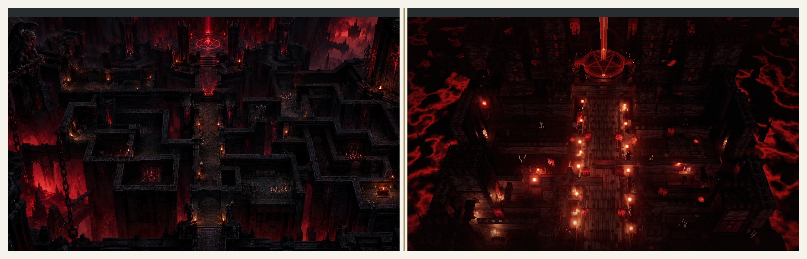
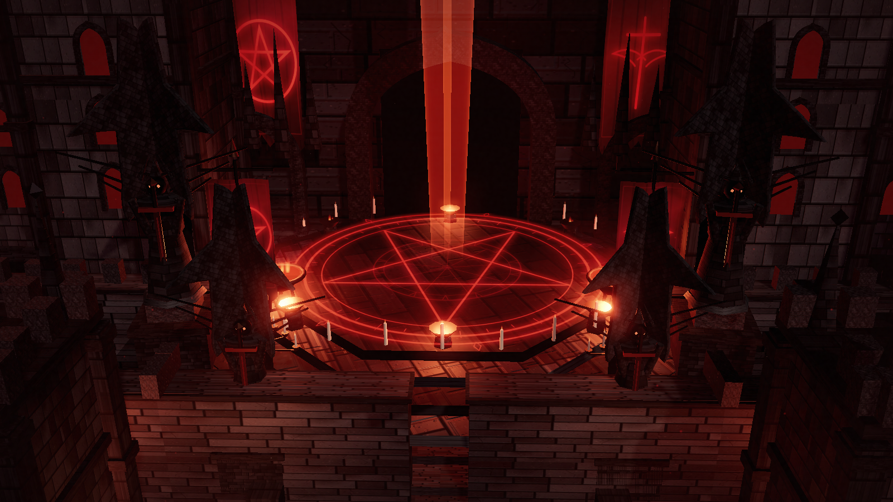

# Visual validation - Infernal Citadel

## Verdict

**Accepted as a stylized procedural reconstruction, not as a metric-complete
match.** The scene is structurally real from four azimuths and carries the
reference's identity features. The deterministic fidelity score is **0.6022**
against a 0.85 target, so the remaining gap is reported rather than hidden.

| Item | Result |
| --- | --- |
| Screenshot capture | Pass - 1600 x 900, fresh, read back |
| Reference comparison | Pass - side-by-side sheet produced |
| Tier-1 diagnostics | Pass - silhouette IoU 0.9049, aspect delta 0.0, scale delta 0.0 |
| Four-azimuth turntable gate | **Pass** - covered, segmented, non-degenerate |
| Multi-angle area collapse | Pass - no degenerate view |
| Divine Eye fidelity | 0.6022 / 0.85 target (low-confidence, probe) |
| RGB histogram intersection | 0.8644 |
| Mean luma | Reference 0.0485 / render 0.0511 |
| Mean saturation | Reference 0.0584 / render 0.1045 |
| Edge density | Reference 0.0714 / render 0.0297 |

## Evidence

- Reference: [infernal-citadel.png](../reference/infernal-citadel.png)
- Hero render: [hero.png](../renders/hero.png)
- HUD render: [hero-ui.png](../renders/hero-ui.png)
- Side-by-side: [comparison.png](../renders/comparison.png)
- Sanctum close-up: [detail.png](../renders/detail.png)
- Axial gate view: [nave.png](../renders/nave.png)
- Orbit contact sheet: [orbit-sheet.png](../renders/orbit-sheet.png)
- Transparent silhouette passes: [silhouette/](../renders/silhouette/)





## Deterministic outputs

- [divine-eye.json](divine-eye.json)
- [diagnose-render.json](diagnose-render.json)
- [diagnose-multi-angle.json](diagnose-multi-angle.json)
- [turntable-gate.json](turntable-gate.json)
- [pixel-comparison.json](pixel-comparison.json)
- [visual-review.json](visual-review.json)

## What was checked by eye

Read back at full size after capture:

1. **Composition** - central processional axis, raised sanctum at the top,
   descending foreground stairs at the bottom, flanking wards and chasm edges.
2. **Portal** - pentagram inlay, red gate void and vertical beam read at the
   intended scale; the beam is heavier than the reference's thin needle.
3. **Architecture** - crenellated towers, pointed arches, lancets, buttresses,
   stairs and walled courts are all present, but less dense and less ruined
   than the reference.
4. **Lava** - animated flow, incandescent fissures and red bounce are visible;
   the reference cuts more lava openings through the interior.
5. **Props** - candles, candelabra, braziers, banners, gargoyle, chains and
   winged sentinels are all visible in the hero frame.
6. **Orbit integrity** - the environment holds up from front, right, rear and
   left; the alpha silhouettes confirm actual volume rather than billboards.

## Remaining mismatch (not a silent pass)

The reference's strongest structural property is **density**: a labyrinth of
overlapping rooms, broken walls, arches and roofs. This reconstruction has the
right macro composition and landmarks, but fewer cells per ward. Its surface is
also more saturated and lacks the reference's high-frequency linework. Those
gaps are why the deterministic fidelity sits at 0.60 and why this is documented
as an accepted stylization.

## Reproduce

```bash
npm run scene:build
node tools/capture-infernal.mjs http://127.0.0.1:5173/ renders hero 1600 900 0 hero
python tools/compare-visual-stats.py --reference reference/infernal-citadel.png --render renders/hero.png --out evidence/pixel-comparison.json
python forge/stage4_review/divine_eye.py --reference reference/infernal-citadel.png --render renders/hero.png --json
```
