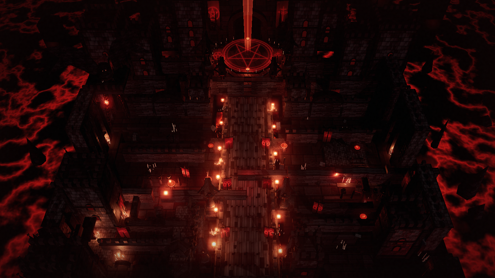

# Infernal Citadel — procedural Three.js diorama

> Part of [Zerlin's img2threejs derivative works](../README.md#二开作品--zerlins-works).

A code-only reconstruction of the supplied dark fantasy reference: a top-down
infernal cathedral-citadel above a lava sea, with a central processional nave,
a pentagram sanctum and blood-red beam, walled wards, candle-lit terraces,
winged sentinels, a perched gargoyle and hanging chains.

No downloaded meshes, textures, HDRIs or art packs are used. The stone, floor,
banner, rune, flame, smoke and glow textures are drawn at runtime on 2D canvases;
the lava and beam are custom GLSL shaders; all architecture is built from
`BoxGeometry`, cylinders, extrusions, lathes, tubes and authored shapes.



## Run it

From the repository root:

```bash
npm install
npm run scene:dev
# open http://127.0.0.1:5173/
```

Production build:

```bash
npm run scene:build
# static output: dist-infernal-citadel/
# serve that directory with any static HTTP server
python -m http.server 5173 --directory dist-infernal-citadel
```

The current workspace preview is served at <http://127.0.0.1:5173/>.

## Controls

| Input | Action |
| --- | --- |
| Left drag | Orbit |
| Wheel | Dolly |
| Right drag | Pan |
| Click a structure | Inspect it; a red bounding box and the dossier update |
| `Explode` / slider | Separate the major structural groups and reassemble them |
| `Hero` | Reference-matched top-down view |
| `Aerial` | Higher plan view |
| `Nave` | Low axial view toward the gate |
| `Orbit` | Slow turntable |
| `Detail` | Close view of the pentagram sanctum |

Query parameters used for deterministic captures:

- `?ui=0` hides the HUD for clean screenshots.
- `?view=hero|aerial|nave|detail|orbit|front|right|rear|left`
- `?alpha=1` renders a transparent-background silhouette pass (used by the
  turntable gate).
- `?cam=x,y,z&look=x,y,z&fov=35` overrides the camera for review.
- `?exposure=`, `?bloom=`, `?fog=` tune the look-dev for experiments.

## What is in the model

- **The Crimson Nave** — a 10-metre processional spine, parapets, crossings,
  banners, candelabra and a descending foreground stair.
- **The Ninth Gate** — raised octagonal sanctum, 16-metre pentagram inlay,
  ring of votive fire bowls, colossal pointed gate and vertical crimson beam.
- **The Twin Bastions / Ashen Ward / Blood Cloister** — walled wards, sunken
  courts, stairs, arcades, reliquary tables, towers and buttresses.
- **The Iron Curtain** — high crenellated outer ramparts with red-lit lancets,
  broken merlons, votive niches and the gargoyle perch.
- **The Sunken Arcade** — ruined three-bay viaduct leaning over the lava.
- **The Molten Abyss** — animated FBM lava with hot fissures, horizon fade and
  ember lights.
- **Props** — 390 animated flames, braziers, candelabra, 12 winged sentinels,
  the gargoyle, giant chain links, rubble, rune plaques and banners with
  tattered alpha-cut hems.
- **Atmosphere** — HDR bloom, red fog, layered vapour sprites, 980 embers and
  320 ash motes.

Runtime hierarchy is preserved as named parts (`The Crimson Nave`, `The Ninth
Gate`, `The Iron Curtain`, etc.) under the `InfernalCitadelModel` root, so the
scene is not one merged mesh. The explode control animates those groups.

## Technical notes

- Three.js r170, TypeScript, Vite.
- Renderer: ACES filmic tone mapping, PCF soft shadows, sRGB output.
- Post: `EffectComposer` → `RenderPass` → `UnrealBloomPass` → `OutputPass`.
- Deterministic procedural textures seeded with `mulberry32`.
- Lava and beam shaders are time-driven but do not use random sampling per frame.
- Approximate budget: **3,519 meshes**, **134k triangles**, **390 flames**,
  **11 lights** at the final hero view (the exact HUD count is sampled from the
  live scene).
- File map:
  - `src/main.ts` — renderer, camera, post, controls, HUD, capture API, interactions.
  - `src/scene/createInfernalCitadel.ts` — assembly, lighting, rune inlays, explode.
  - `src/scene/architecture.ts` — walls, towers, arches, stairs, platforms, chains.
  - `src/scene/props.ts` — sentinels, gargoyle, candles, torches, braziers, candelabra.
  - `src/scene/effects.ts` — lava, beam, sky, haze, embers, ash, lava lights.
  - `src/scene/procedural.ts` — canvas textures, PBR materials, GLSL shaders.
  - `src/style.css` — HUD, title treatment, film grain and vignette.

## Visual verification

Evidence lives in `../renders/` and `../evidence/`:

- `renders/hero.png` — reference-matched hero frame.
- `renders/hero-ui.png` — live HUD.
- `renders/explode-ui.png` — exploded structural groups.
- `renders/nave.png` — axial gate view.
- `renders/detail.png` — sanctum / pentagram close-up.
- `renders/orbit-sheet.png` — front / right / rear / left orbit contact sheet.
- `renders/comparison.png` — reference and render side by side.
- `renders/silhouette/` — transparent-background turntable passes.
- `evidence/divine-eye.json` — deterministic visual evaluator.
- `evidence/diagnose-render.json` — Tier-1 pixel diagnostics.
- `evidence/diagnose-multi-angle.json` — orbit area-collapse check.
- `evidence/turntable-gate.json` — mandatory four-azimuth coverage gate (passes).
- `evidence/pixel-comparison.json` — colour / luma / edge statistics.
- `evidence/visual-review.json` — human-readable semantic layer scoring.
- `evidence/visual-validation.md` — consolidated verification report.

### Known limitations

This is a **stylized single-view reconstruction**, not photogrammetry or an exact
architectural copy. The reference is a 2D painting; hidden backs, exact
dimensions, roof plans and unseen chambers are inferred. The generated plan is
more regular than the reference's asymmetric ruined sprawl, and the surface
detail is deliberately procedural rather than pixel-projected. The deterministic
fidelity score is below the pipeline's object-reconstruction target, so the
result is documented as an accepted stylization rather than a metric-complete
match.
