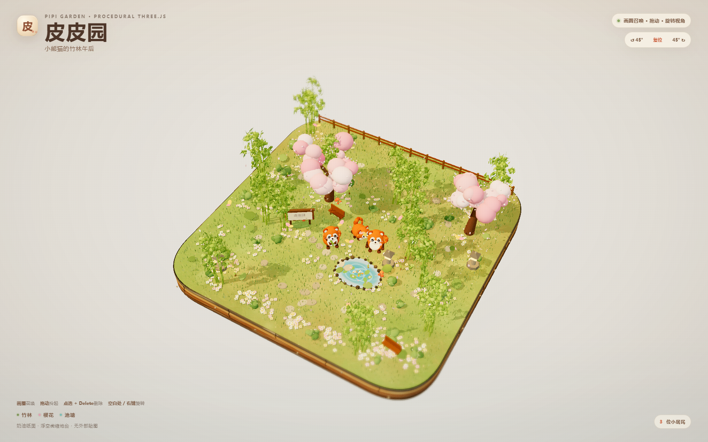

# 皮皮园 · Pipi Garden

> Part of [Zerlin's img2threejs derivative works](../README.md#二开作品--zerlins-works).

一个完全由代码生成的 Three.js 微缩场景：奶油色纸面上漂浮着一块圆角地台，
小熊猫在竹林、樱花、池塘和小木牌之间生活。

**Stage B 互动版已完成**：画圈召唤、拖拽拎起、Delete 删除、视角旋转、
草稿/全画质切换、小跟大、10 只性能测试和手机布局均已接入。地台面积扩到
原来的 **3 倍**（约 20.8×20.8），中央花园外增加了一圈竹林、花海、草坡、
围栏、第二棵樱花和石径等装饰。



## Run

From the repository root:

```bash
npm run scene:pipi:dev
# http://127.0.0.1:5176/
npm run scene:pipi:build
npm run scene:pipi:preview
# http://127.0.0.1:5177/
npm run scene:pipi:bundle
# single file: dist-pipi-garden/pipi-garden.html
```

The existing `infernal-citadel` scene is untouched and keeps its own scripts.

## Interactions

| Input | Action |
| --- | --- |
| Draw a circle on the moss | Spawn a red panda inside the loop; larger loop = larger panda |
| Drag a panda | Lift it; release on water/obstacle snaps to the nearest walkable spot |
| Click a panda + `Delete` / `Backspace` | Send it home; the mobile card also has a 删除 button |
| Drag blank paper / right-drag | Rotate yaw and pitch; the camera auto-fits the diorama |
| `↺ 45°` / `复位` / `45° ↻` | Camera presets; arrow keys also rotate |
| `?pandas=0` | Start with an empty garden for lasso testing |

A loop that crosses water, bamboo, the platform edge or another obstacle shows
“换块空地画圈吧”. The population cap is 30.

## Views

| URL | View |
| --- | --- |
| `?view=hero&pandas=3` | full diorama with three live residents |
| `?view=poses` | five-pose character sheet |
| `?view=closeup&pose=eat` | single red panda close-up |
| `?ui=0` | hide the HUD for clean capture |
| `?freeze=1&t=2.2` | deterministic still frame |
| `?yaw=0&pitch=48` | camera override in degrees |

## What is built

- **Floating diorama** — rounded-square slab, layered soil cut face with seams,
  roots and embedded stones, soft paper shadow, no downloaded assets. The
  playable ground is 20.8×20.8 (3× the original area); the central 12×12 garden
  is surrounded by a new meadow ring with a second sakura, extra bamboo groves,
  flower patches, shrubs, rocks, mushrooms, a fence, lanterns and stone paths.
- **Painted ground** — procedurally generated 2048² moss texture with 30k+
  brush marks, colour patches, a dirt path, flowers and grit; a bump map adds
  tactile response.
- **Garden** — five bamboo clusters with leaf fans, a sakura tree, pond with
  shader water, koi, lily pads, wooden sign “皮皮园”, stone lantern, bench,
  rocks, mushrooms, flowers, tall grass, stepping stones, bushes, petals,
  butterflies and floating motes.
- **Red panda** — code-built sphere/capsule character: rust coat, cream muzzle
  and drooping eye patches, ringed tail, blush, catchlights, blinking, and five
  poses (`walk`, `sit`, `eat`, `wag`, `idle`). Eating uses a second pair of
  longer arms and a bamboo shoot.
- **Behaviour** — random action state machine, home-circle wandering,
  separation/right-of-way, small-follows-large, and obstacle/water avoidance.
- **Spawning** — lasso overlay, easeOutBack scale-in, star burst, toast
  feedback, 30 cap and circle-size-to-panda-size mapping.
- **Camera** — perspective 3/4 view with automatic fit based on projected
  silhouette points; the platform and tall props stay inside the frame at every
  yaw. Dragging uses a direct draft render and fades back to the full
  tilt-shift composer when the camera settles.
- **Look** — left-top warm key, cool fill, ACES tone mapping, tilt-shift blur,
  contrast/saturation grade, warm-to-cool paper light and fine grain.
- **No external art** — every texture is drawn on a 2D canvas at runtime; no
  images, models, HDRIs or web fonts are downloaded.

## File map

```text
index.html
src/main.ts                 renderer, views, camera controls, lasso/HUD, test API
src/style.css               cream-paper HUD, lasso layer, toast, responsive layout
src/scene/createPipiGarden.ts
src/scene/terrain.ts        slab, ground, pond, strata details
src/scene/props.ts          bamboo, sakura, sign, lantern, rocks, flowers
src/scene/character.ts      red panda rig, poses, blink, eating arms
src/scene/pandaSystem.ts    agents, wander/follow/separation, drag/drop, spawning
src/scene/particles.ts      star burst / spawn ring
src/scene/ambient.ts        petals, butterflies, koi, lily pads, motes
src/scene/cameraRig.ts      projected-bounds camera fit
src/scene/postprocess.ts    tilt-shift + grade
src/scene/procedural.ts     deterministic canvas textures and helpers
tools/test-pipi-interaction.mjs
tools/capture-pipi.mjs
tools/validate-pipi-static.mjs
```

## Verification

```bash
npm run scene:pipi:check
npm run scene:pipi:build
npm run scene:pipi:test
# 37 interaction checks: expanded ground/decor, lasso scale, invalid water,
# drag/snap, delete, camera drag/draft/full, buttons, arrows, fit, follow,
# 30 cap, 10-panda FPS, mobile
node tools/validate-pipi-static.mjs http://127.0.0.1:5176/ pipi-garden/evidence/static-check.json
```

Measured on headless Chromium with the NVIDIA GTX 1650 SUPER D3D11 backend at
1600×1000: **10 pandas, 135–165 fps across runs (last run 165.2), 722 draw calls,
830,735 triangles**. The browser test also covers 390×844 mobile lasso, HUD
bounds and the full platform remaining inside the mobile frame. These are
run-time measurements on this machine, not a blanket guarantee for every GPU.

Fresh captures live in `renders/`; evidence lives in
`evidence/interaction-test.json`, `evidence/static-check.json`,
`evidence/stageb-review.json` and `evidence/stageb-validation.md`.

## Known limitations

- The sakura canopy is deliberately stylized (cluster-of-spheres language)
  rather than botanically detailed.
- The cut-face strata are simplified to colour bands, seams and a few 3D roots.
- At full-diorama distance the painted ground reads as soft mottling rather than
  individual brush strokes.
- The 3× ground makes the auto-fit camera pull back, so pandas are smaller than
  in the original 12×12 layout; the camera still keeps the complete platform and
  tall props inside the frame.
- Thirty pandas is a hard cap and will crowd the diorama; the 60 fps target is
  validated at ten pandas.
- Mobile is verified for layout, lasso and touch-friendly controls, not for a
  ten-panda 60 fps benchmark on low-end phones.

